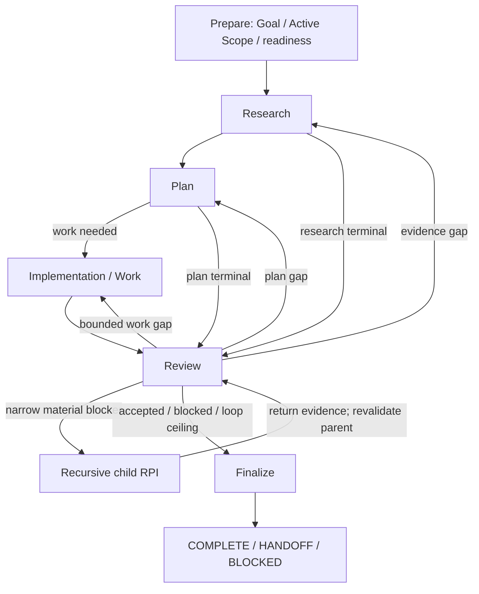

# Textweft Project Workflows

이 디렉터리는 **프로젝트 업무 흐름**의 Git 추적 정본입니다. 에이전트 역할이나 권한을 정의하지 않습니다. 공통 권한·승인은 [AGENTS.md](../../AGENTS.md), 요청 단계는 [Workflow Selection](../../docs/development/workflows/choosing.md), 일상 작업 최소 기준은 [Routine Loop](../../docs/development/workflows/routine-loop.md)가 소유합니다.

## Standard Execution: Adaptive RPI(R)

프로젝트 기본 실행 모델은 **Prepare → RPI Main Loop → Finalize**입니다. Main Loop의 `Research → Plan → Implementation/Work → Review`는 단방향 단계표가 아니라 **근거와 선행 관계를 지키며 Review가 다음 전이를 결정하는 적응형 루프**입니다. 복잡한 실행의 상세 제어(반복 횟수·강도·범위·재귀·종료)는 이미 채택한 `mols-loops` Skill이 소유합니다. 이 문서는 프로젝트 Workflow와의 연결만 정의하며 이를 별도 엔진으로 복제하지 않습니다.

### Adaptation Rules

- **Prepare:** 현재 저장소·ref·도구·승인과 목표, **Active Scope(Goal / In scope / Out of scope / Acceptance)**를 확인합니다. 유효한 작업 범위와 실제 실행 권한을 혼동하지 않습니다.
- **Research → Plan → Work:** 중요한 증거를 먼저 수집하고 수용 조건·작업 의존성·검증 기준을 계획한 뒤, 승인된 범위의 Work만 수행합니다. Work는 구현 코드뿐 아니라 문서·설정·분석·테스트 등도 포함합니다. 독립 작업 단위는 의존성을 지키며 선택적으로 구성하고, 이미 유효한 단위는 무조건 재실행하지 않습니다.
- **Review → Dispatch:** 수용 조건을 검증하고 반례·회귀·미확인을 검토한 다음, **최초로 무효화된 단계**로 돌아갑니다(근거 부족 → Research, 계획/명세 부족 → Plan, 유효한 계획 안의 국소 결함 → Work). Review는 새 범위나 승인 권한을 스스로 만들 수 없습니다.
- **Recursive child:** Review가 발견한 중요하고 더 좁은 독립 해결 문제에만 하위 Active Scope를 구성합니다. 자식은 부모의 비목표·수용 조건·안전·권한·승인·인계·실행 예산을 **상속하거나 축소**하며, **반복 횟수도 공유**합니다. 자식 결과를 부모에 병합하기 전 부모 Research/Plan/검증의 유효성을 다시 확인합니다. 무의미한 재귀를 강제하지 않습니다.
- **Scope change:** 범위를 넓힐 필요가 생겨도 먼저 Research로 필요성과 경계를 확인하고 Plan에 반영한 뒤 **기존 승인 게이트를 통과할 때만** 변경합니다. 명시적 제외 범위·중요한 사람 결정을 묵시적으로 변경할 수 없습니다.
- **Finalize:** Review가 수용 조건 충족, 진행 차단, 또는 반복 예산 소진을 판정할 때만 종료 심사를 진행합니다. 최종 상태는 **COMPLETE / HANDOFF / BLOCKED** 중 하나이며, 미실행 검사·남은 중요한 결함·소진된 예산을 성공으로 표현하지 않습니다.

**Implementation의 지역 불변식:** 관찰 가능한 소프트웨어 동작을 변경하는 **각 작업 단위**에서는 [Delivery](delivery/WORKFLOW.md)의 **Spec → 테스트 설계 → 테스트 구현 → 실제 구현** 순서가 성립해야 합니다. 상위 루프가 Work로 되돌아오거나 재귀 자식이 코드를 수정하더라도 이 선행 조건은 유지됩니다. 테스트/명세가 무효화되었다면 먼저 관련 선행 단계부터 갱신합니다.

**요청 단계 경계:** RPI Research 단계 자체가 최종 목표라면 Research → Review, RPI Plan 단계가 최종 목표라면 Research → Plan → Review 후 Finalize할 수 있습니다. 일반 조사·계획·리뷰 *산출물*은 필요하면 Work 안에서 수행할 수 있으므로 단계 이름만 보고 종료하지 않습니다. 요청이 준비/리뷰에 한정되었다면 Implementation이나 병합으로 넘어가지 않습니다.

**운용 비용:** 단순 작업도 근거·계획·검증의 순서는 유지하되, 형식적인 별도 계획서·자식 루프·반복 횟수 채우기를 강제하지 않습니다. 복구 가치가 있는 복잡한 작업의 중간 상태만 기존 [Inbox](../../.inbox/README.md)에 남기고 재개 시 최신 원격 근거를 우선합니다.

## Select by Outcome

사용자의 의도와 허용 범위에 해당하는 **주 Workflow 하나**를 선택하고 해당 `WORKFLOW.md`만 읽습니다. 필요한 경우에만 다른 Workflow를 보조로 호출합니다.

| 요청·상황 | 선택할 Workflow | 선택하지 않을 경우 |
| --- | --- | --- |
| 사용자가 직접 선택한 자율 작업자가 목표에서 다음 일을 고르고 진행 | [Autopilot](autopilot/WORKFLOW.md) | 일반 에이전트의 자동 위임이나 단순한 작업 요청 |
| 사실 조사·설계·대안 비교·계획이 최종 결과 | [Investigation](investigation/WORKFLOW.md) | 구현이 이미 승인되어 결과물이 변경인 경우 |
| 코드·문서·설정·테스트를 수정하고 인계 | [Delivery](delivery/WORKFLOW.md) | 리뷰·조사 결과만 요청한 경우 |
| 변경·구조·문서·하네스의 문제점과 근거 평가 | [Review](review/WORKFLOW.md) | 기존 Finding에 따른 수정을 주로 요청한 경우 |
| 반복 문제를 찾아 에이전트·규칙·절차·CI 개선 | [Harness Improvement](harness-improvement/WORKFLOW.md) | 순수한 하네스 동작 평가만 필요한 경우 |
| 에이전트 선택·위임·권한·작업 품질의 실제 평가 | [Harness Evaluation](harness-evaluation/WORKFLOW.md) | 정적 설정/Markdown 형식 검사만 필요한 경우 |
| 실패한 CI·검증·도구 실행의 원인 규명과 복구 | [Failure Recovery](failure-recovery/WORKFLOW.md) | 실패 없이 새 기능을 구현하는 경우 |
| 이전 실행·세션·작업 주체로부터 안전한 작업 이어가기 | [Resumption](resumption/WORKFLOW.md) | 현재 상태만으로 충분한 짧은 작업 |
| **명시적인** PR 병합 요청 | [Integration](integration/WORKFLOW.md) | PR 생성·리뷰 또는 CI 통과만 한 경우 |

## Composition and Boundaries

- **Workflow**는 단계·결과·중단 경계를 소유합니다. **Skill**은 전문 작업법, **Subagent**는 별도 실행 단위, **Command**는 해당 런타임의 진입점입니다. 이 파일들은 Rulesync 생성 대상이 아닌 프로젝트 문서로, 자동 발견·호출을 보장하지 않습니다.
- Autopilot은 직접 선택된 최상위 실행에서만 목표와 다음 작업을 조정합니다. 일반 에이전트는 부여받은 작업 범위에서 전문 Workflow를 직접 선택할 수 있지만, 위임 호출로 Autopilot의 권한을 얻지 못합니다.
- 복잡한 작업의 반복 방법이 필요하면 기존 `mols-loops` Skill을 사용합니다. Workflow마다 새 범용 루프·로그·검증 엔진을 만들지 않습니다.
- 요청이 **준비·리뷰** 단계라면 Workflow를 선택했다는 이유로 구현이나 병합으로 이동하지 않습니다. 별도 허용된 수정도 [AGENTS.md](../../AGENTS.md)의 권한 범위 안에서만 수행합니다.
- 필수 근거·도구·승인이 없으면 해당 동작을 중단하거나 한계를 밝히고 인계합니다. 긴 작업의 기록은 [Inbox](../../.inbox/README.md)의 기존 작업 상태를 재사용합니다.
- **현재 개발 우선순위** P0 하네스 → P1 MVP 설정 → P2 MVP 구현은 [Development](../../docs/development/README.md)가 소유합니다. 이 목록은 새로운 제품 결정을 뜻하지 않습니다.

## Minimal Workflow Contract

각 `<name>/WORKFLOW.md`는 적용·제외 조건, 필요한 입력, 작업 흐름, 확인 가능한 종료 기준, 차단·인계를 설명합니다. 공통 정책은 링크로 참조하며 중복 복제하지 않습니다. 특정 Workflow에 실제 별도 자료가 필요할 때만 하위 파일을 추가합니다.

**검증 수준:** Markdown·링크·CI 성공은 정적 구성의 증거입니다. 실행 라우팅·위임 거절·에이전트 독립성·자율 선택의 성능은 [Harness Evaluation](harness-evaluation/WORKFLOW.md)에 따라 실제 런타임에서 별도 관찰해야 합니다.
